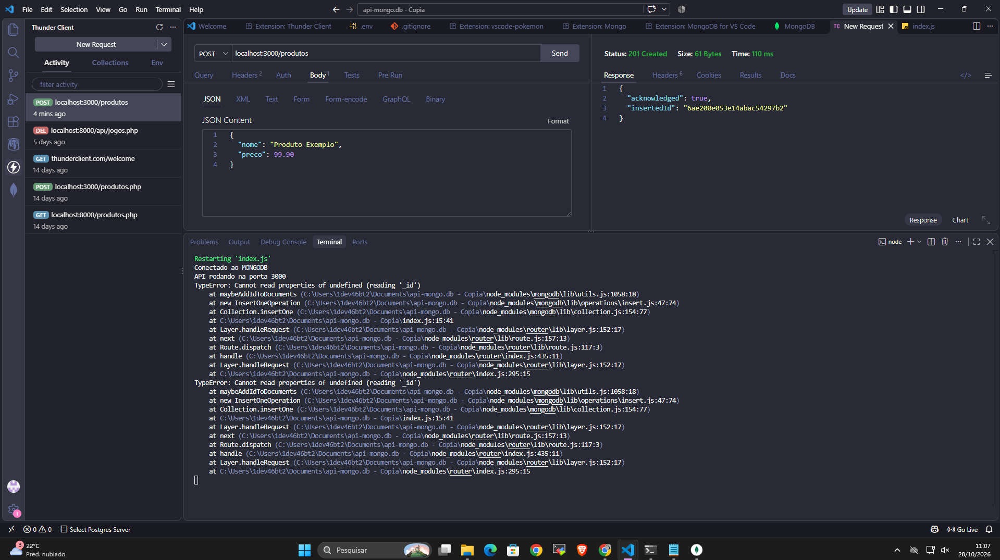
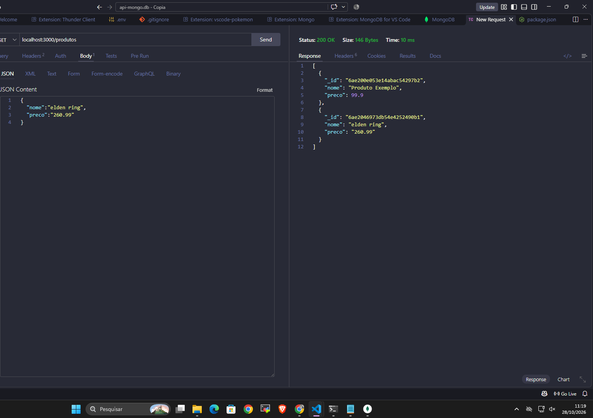
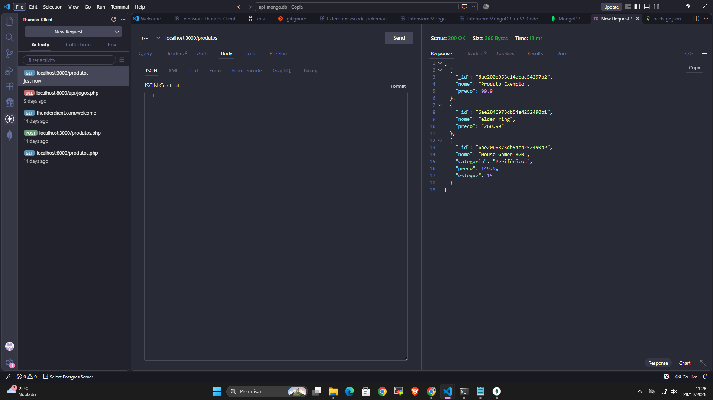
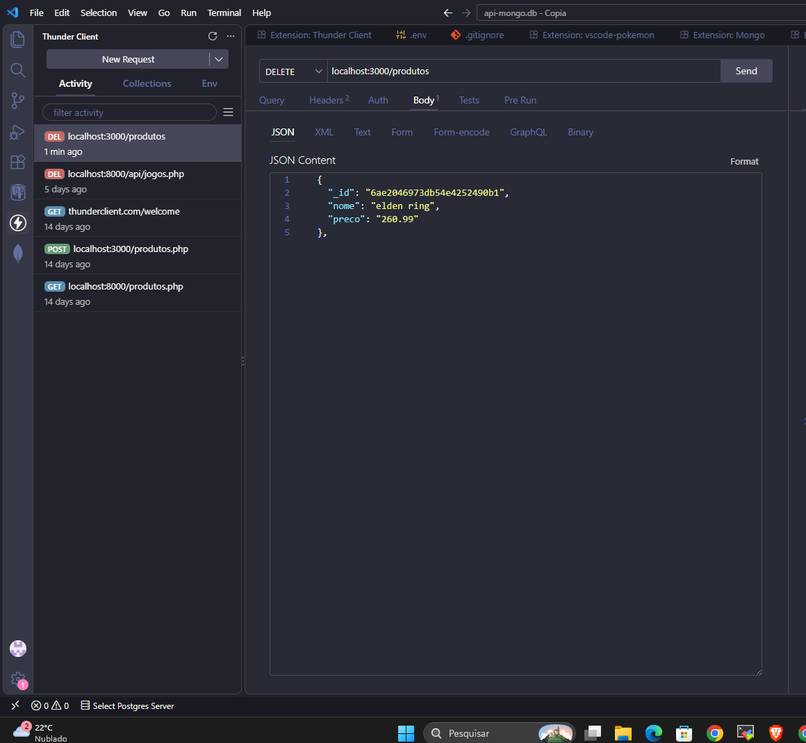
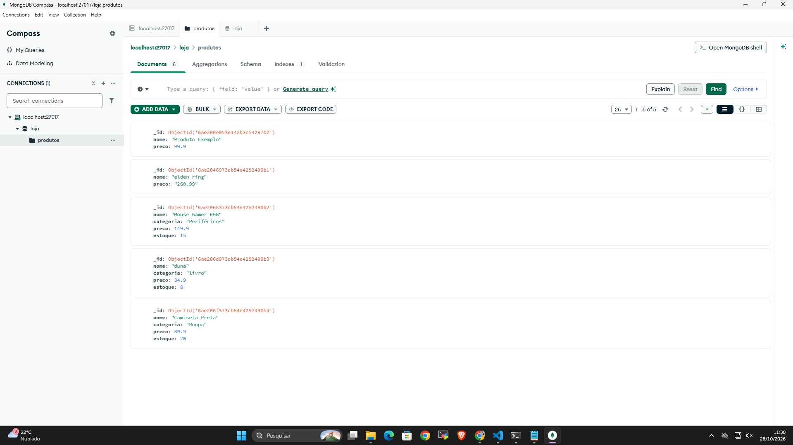

# API MongoDB  Loja

## Sobre o projeto

Este projeto foi desenvolvido durante as aulas com o objetivo de criar uma API utilizando Node.js, Express e MongoDB.

A API permite realizar operações de cadastro, consulta, atualização e exclusão de produtos, utilizando os métodos HTTP.

## Tecnologias utilizadas

- Node.js
- Express
- MongoDB
- Thunder Client
- JavaScript

## Estrutura do projeto

```text
api-mongo.db/
├── node_modules/
├── .env
├── .gitignore
├── index.js
├── package-lock.json
├── package.json
└── readme.md
```

## Configuração do projeto

1. Instalar as dependências:

```bash
npm install
```

2. Configurar o arquivo `.env` com a conexão do MongoDB:

```env
MONGO_URI=sua_string_de_conexao
```

3. Executar o projeto:

```bash
node index.js
```

Após a conexão com o banco de dados, a API será iniciada na porta 3000.

## Banco de dados

Foi utilizado o MongoDB, com o banco de dados chamado `loja` e a coleção `produtos`.

## Rotas da API

| Método HTTP | Rota | Funcionalidade |
|---|---|---|
| POST | `/produtos` | Cadastrar um produto |
| GET | `/produtos` | Listar todos os produtos |
| GET | `/produtos/:id` | Buscar produto pelo ID |
| PUT | `/produtos/:id` | Atualizar um produto |
| DELETE | `/produtos/:id` | Excluir um produto |

## Testes com Thunder Client

Os testes das requisições foram realizados utilizando a extensão Thunder Client no Visual Studio Code.

### Cadastro de produtos (POST)



### Listagem de produtos (GET)



### Busca de produto por ID (GET)



### Exclusão de produto (DELETE)


### Usando o MongoDB


